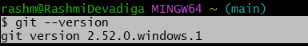
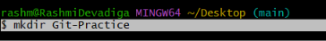
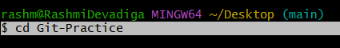
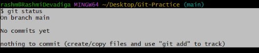

# Day 2 - Tasks

## 1. Install Git on your system and confirm it with `git --version`.

**Git Version**

## 2. Create a folder, run `git init` inside it, and take a screenshot of the output.

**Create a folder (mkdir)**

**Change directory (cd)**

**Initialize Git repository**

**Check repository status**

