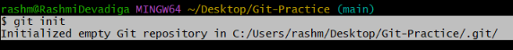

# Day 2 - Tasks

### 1. Install Git on your system and confirm it with `git --version`.

**Screenshot: Git Version**

### 2. Create a folder, run `git init` inside it, and take a screenshot of the output.

**Screenshot 1: Create a folder (mkdir)**

**Screenshot 2: Change directory (cd)**

**Screenshot 3: Initialize Git repository**

**Screenshot 4: Check repository status**

