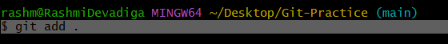
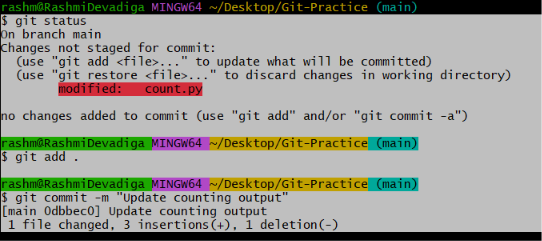
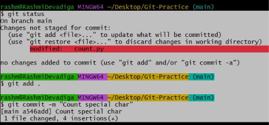
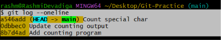
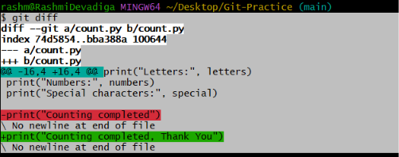

# Day 3 - Tasks

### **1. In your practice repository, make three separate commits, each with a meaningful message describing what changed**

**Commit 1**

(ss/commit-11.png)

**Commit 2**

**Commit 3**

### **2. Run `git log --oneline` and take a screenshot of your commit history.**

**Git Commit History**

### **3. Make one change to a file, run `git diff` before staging it, and see what the output looks like.**

**Git Diff Output**

