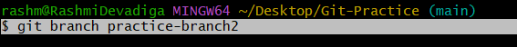
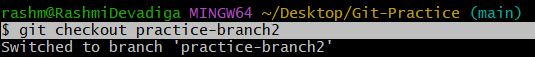
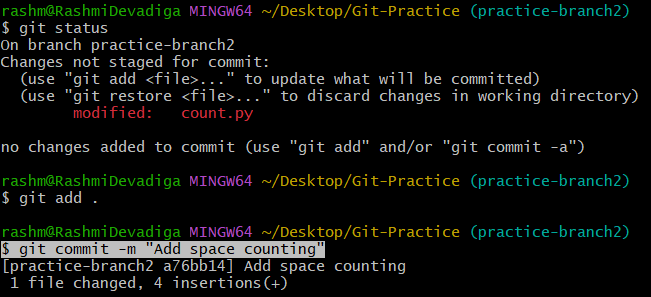
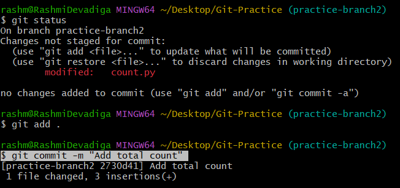
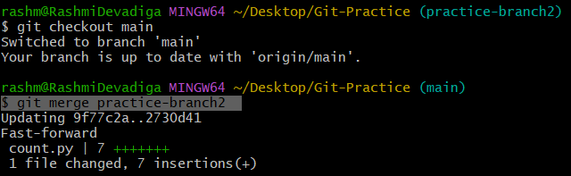
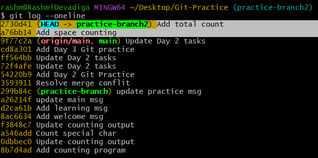
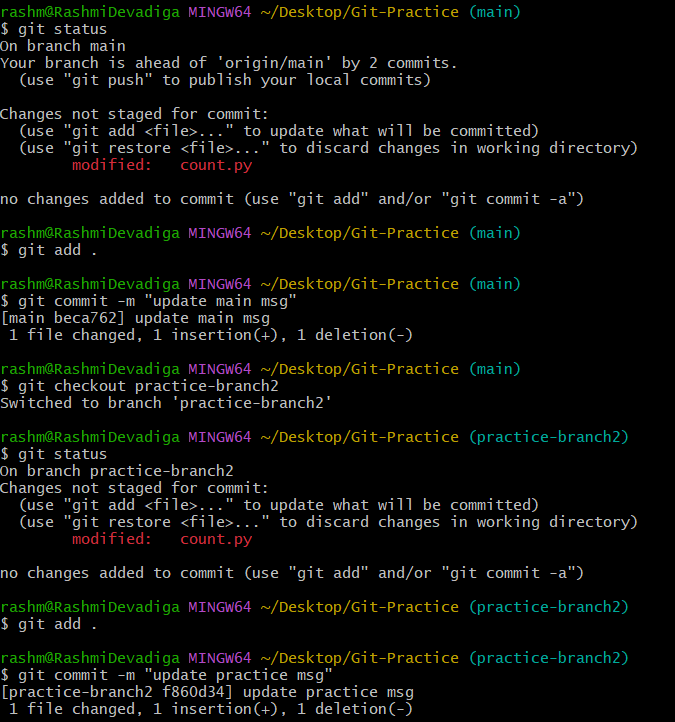
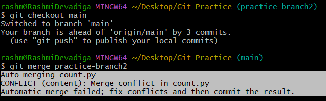
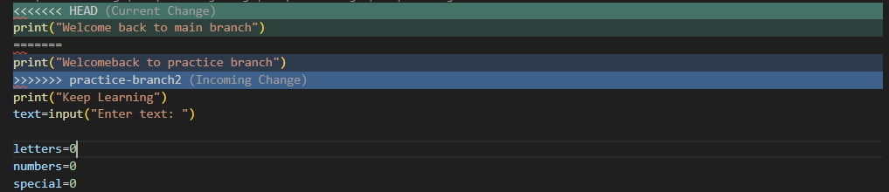
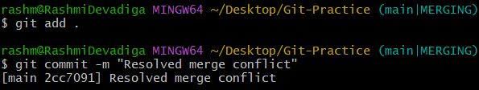

# Day 4 - Tasks

### **1. Create a new branch called `practice-branch` in your repository and make two commits on it.**

**Create Branch**

**Commit 1**

**Commit 2**

### **2. Merge `practice-branch` back into `main` and confirm the changes are there with `git log`.**

**Switch to Main Branch & Merge Practice Branch**

**Git Commit History**

### **3. Deliberately create a merge conflict: change the same line differently on two branches, try to merge, and resolve it by hand.**

**Make Changes on Both Branches**

**Merge Conflict**

**Resolve Conflict Manually**

**Git Commit History After Merge**

